# Diagramas de Sequência — Sistema de Moeda Estudantil

Este documento reúne os **13 diagramas de sequência** dos casos de uso (incluindo os relacionamentos `<<include>>`) do Sistema de Moeda Estudantil, seguindo a arquitetura MVC em camadas do projeto (`View/Frontend` → `Controller` → `Service` → `Repository` → `Banco de Dados`). Emails passam por uma fila persistente e são entregues por Resend ou SMTP após o commit.

---

## 1. Solicitar transferência de moeda para outro aluno (Ator: Aluno)

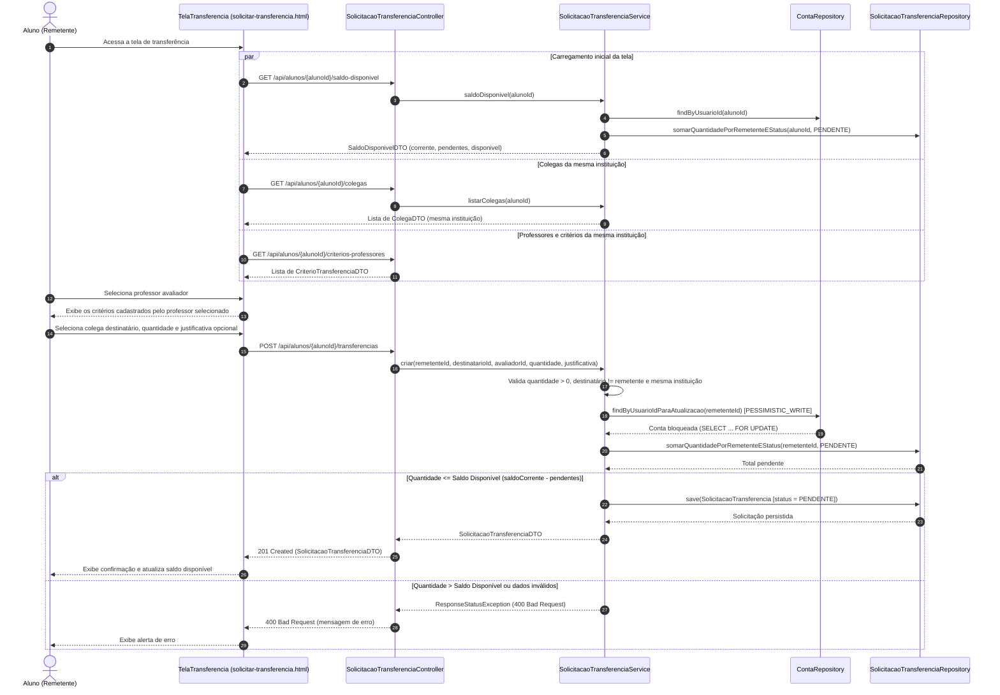

---

## 2. Resgatar vantagem (Ator: Aluno)

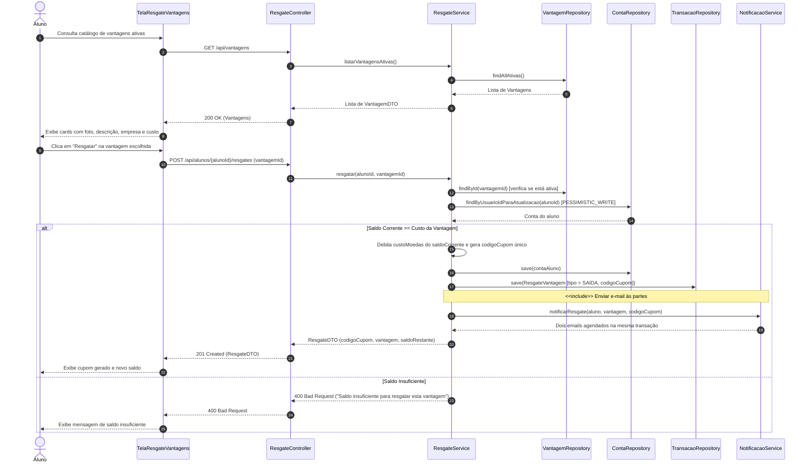

---

## 3. Enviar e-mail às partes (`<<include>>` de Resgatar Vantagem)

```mermaid
sequenceDiagram
    autonumber
    participant RS as ResgateVantagemService
    participant ES as NotificacaoService
    participant DB as EmailPendenteRepository / MySQL
    participant W as EmailOutboxScheduler / Processor
    participant API as EmailSender (Resend ou SMTP)
    actor A as Caixa de E-mail (Aluno)
    actor E as Caixa de E-mail (Empresa Parceira)

    Note over RS,ES: Incluído ao confirmar o resgate de uma vantagem (RF-009 e RF-010)
    RS->>ES: notificarResgate(aluno, vantagem, codigoCupom)
    ES->>ES: Monta templates com o mesmo código do cupom
    ES->>DB: saveAll(emailAluno, emailEmpresa)
    ES-->>RS: Agendamento concluído
    Note over RS,DB: Commit confirma resgate e emails juntos; rollback descarta ambos
    loop Uma mensagem elegível por rodada após commit
        W->>DB: buscarProntos(PENDENTE, agora, limite 1) com bloqueio
        W->>API: enviar(mensagem, chaveIdempotencia)
        alt Provedor aceitou
            W->>DB: ENVIADO e data do aceite
            API-->>A: Cupom do aluno (quando destinatário)
            API-->>E: Código de conferência (quando destinatário)
        else Falha
            W->>DB: Reagendar com atraso ou FALHOU após 5 tentativas
        end
    end
```

---

## 4. Realizar cadastro (Ator: Aluno)

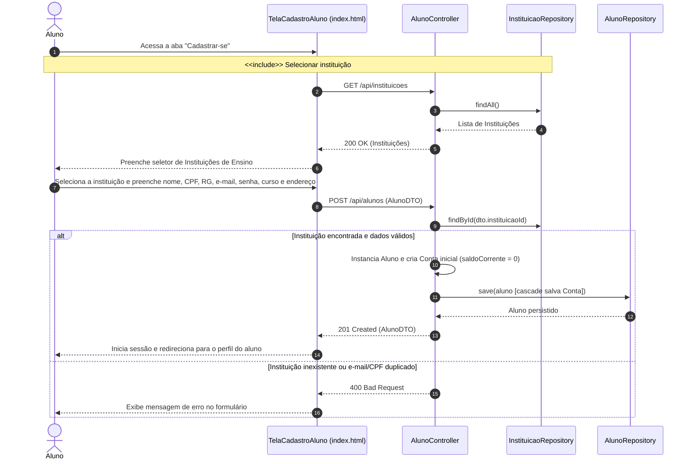

---

## 5. Selecionar instituição (`<<include>>` de Realizar Cadastro)

```mermaid
sequenceDiagram
    autonumber
    actor A as Aluno
    participant V as TelaCadastroAluno (index.html)
    participant C as AlunoController
    participant IR as InstituicaoRepository

    Note over A,IR: Executado durante o caso de uso "Realizar cadastro" (RF-002)
    V->>C: GET /api/instituicoes
    C->>IR: findAll()
    IR-->>C: Lista de Instituicao (pré-cadastradas no sistema)
    C-->>V: 200 OK (JSON com id e nome das instituições)
    V->>V: Renderiza opções no campo <select id="instituicao">
    A->>V: Escolhe sua instituição de ensino na lista
    V->>V: Vincula instituicaoId aos dados do formulário de cadastro
```

---

## 6. Consultar extrato (Atores: Professor e Aluno)

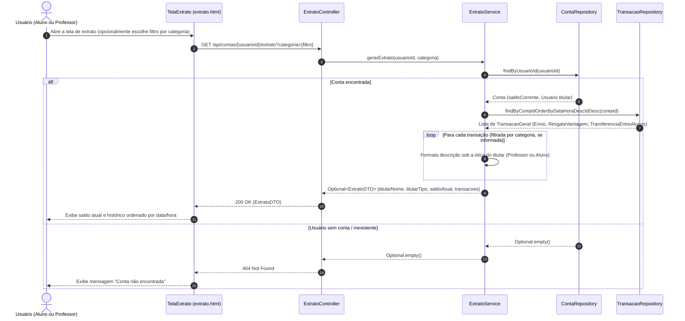

---

## 7. Distribuir moedas (Ator: Professor)

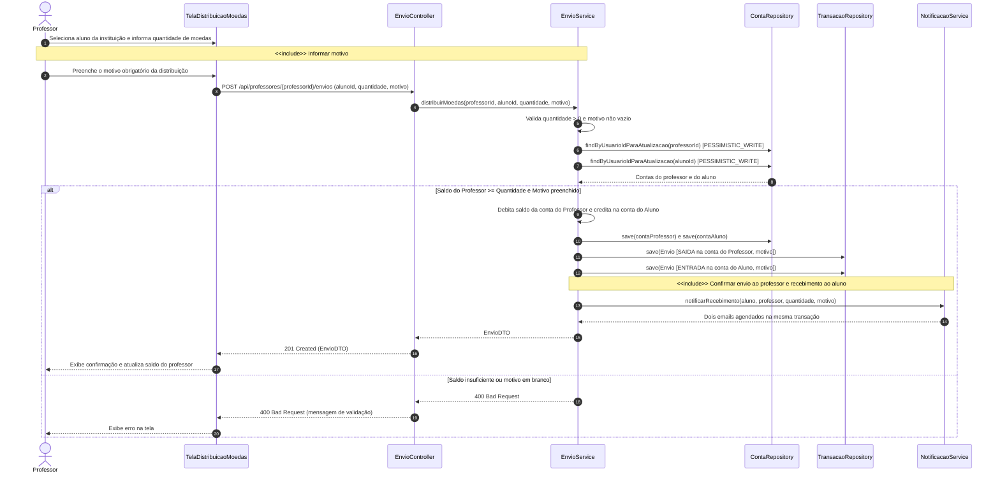

---

## 8. Informar motivo (`<<include>>` de Distribuir moedas)

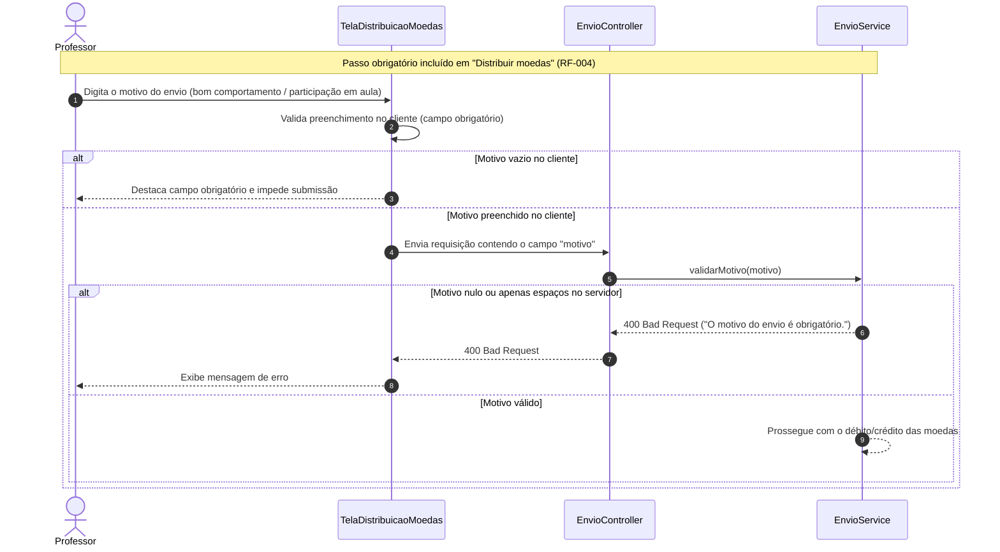

---

## 9. Confirmar envio e recebimento por email (`<<include>>` de Distribuir moedas)

```mermaid
sequenceDiagram
    autonumber
    participant ES as DistribuicaoMoedasService
    participant EM as NotificacaoService
    participant DB as EmailPendenteRepository / MySQL
    participant W as EmailOutboxScheduler / Processor
    participant API as EmailSender (Resend ou SMTP)
    actor A as Caixa de E-mail (Aluno)
    actor P as Caixa de E-mail (Professor)

    Note over ES,EM: RF-005 e Lab04S01: um template por perfil
    ES->>EM: notificarRecebimento(aluno, professor, quantidade, motivo)
    EM->>EM: Monta templates com participantes, quantidade e motivo
    EM->>DB: saveAll(emailAluno, emailProfessor)
    EM-->>ES: Agendamento concluído
    Note over ES,DB: Commit confirma saldos e emails juntos; rollback descarta ambos
    loop Uma mensagem elegível por rodada após commit
        W->>DB: buscarProntos(PENDENTE, agora, limite 1) com bloqueio
        W->>API: enviar(mensagem, chaveIdempotencia)
        alt Provedor aceitou
            API-->>A: Confirmação de recebimento (quando destinatário)
            API-->>P: Confirmação de envio (quando destinatário)
            W->>DB: ENVIADO e data do aceite
        else Falha
            W->>DB: Reagendar com atraso ou FALHOU após 5 tentativas
        end
    end
```

---

## 10. Cadastrar critérios de transferência (Ator: Professor)

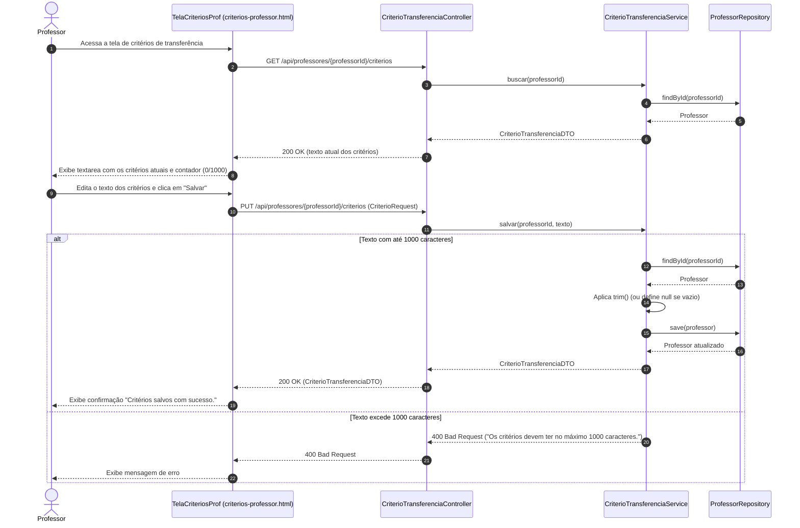

---

## 11. Avaliar solicitações de transferência (Ator: Professor)

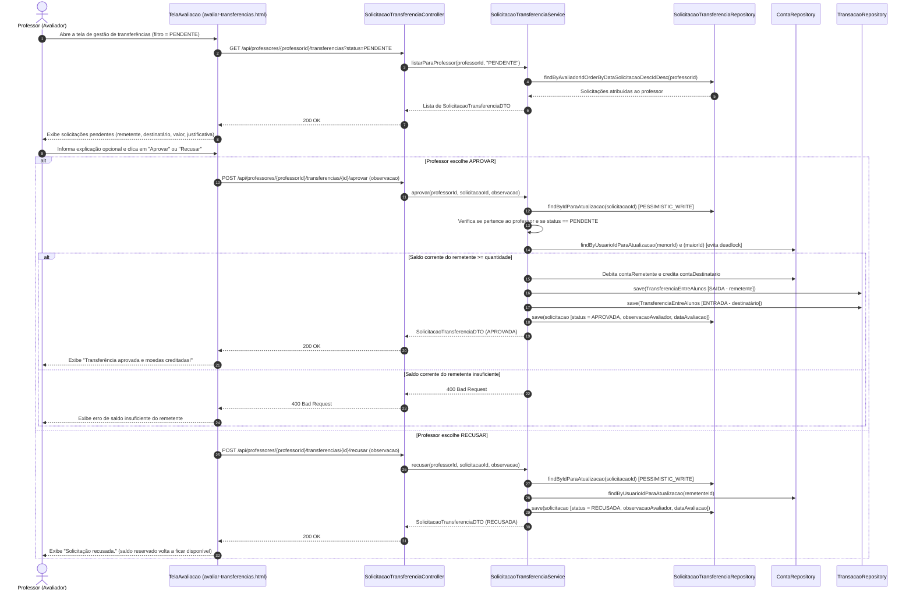

---

## 12. Cadastrar no sistema (Ator: Empresa Parceira)

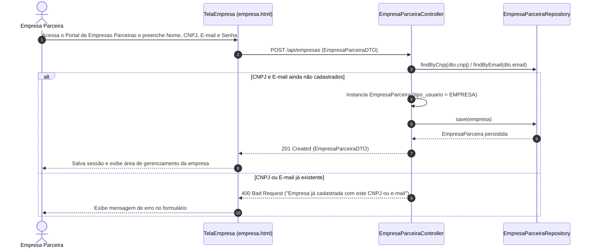

---

## 13. Gerenciar vantagens (Ator: Empresa Parceira)

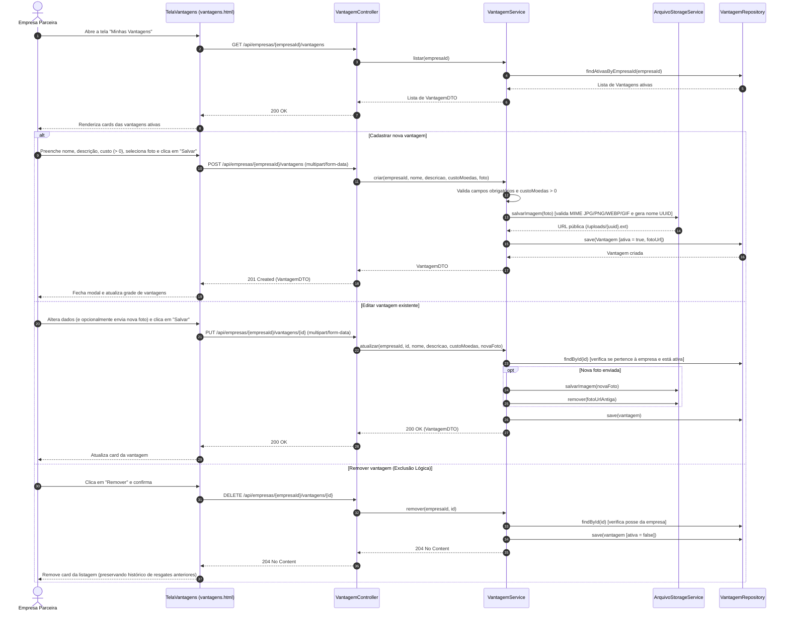
