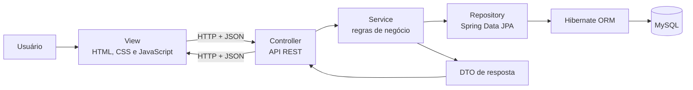
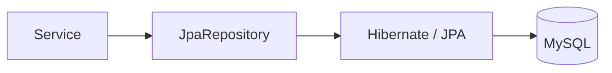

# Sistema de Moeda Estudantil

Projeto desenvolvido para a disciplina de **Laboratório de Desenvolvimento de Software** do curso de Engenharia de Software da PUC Minas.

O sistema tem o objetivo de estimular o reconhecimento do mérito estudantil através de uma moeda virtual, que pode ser distribuída por professores aos alunos e trocada por produtos e descontos em empresas parceiras.

---
## 1. Requisitos do sistema

### 1.1 Requisitos funcionais (RF):
- **RF-001:** O usuário pode autenticar no sistema
- **RF-002:** O aluno pode selecionar uma instituição participante a partir de uma lista de opções. 
- **RF-003:** O sistema deve adicionar ao saldo corrente do professor 1000 (mil) moedas a cada semestre.
- **RF-004:** O professor pode distribuir moedas aos alunos, indicando o motivo da transferência.
- **RF-005:** O sistema deve notificar ao aluno que ele recebeu moeda(s) de um professor.
- **RF-006:** O professor e o aluno podem consultar o extrato da sua conta.
- **RF-007:** O aluno pode trocar moedas por uma vantagem.
- **RF-008:** A empresa parceira pode gerenciar vantagens que deseja oferecer, bem como o custo em moedas estudantis.
- **RF-009:** O sistema deve enviar um email  com cupom ao aluno quando ele resgata uma vantagem.
- **RF-010:** O sistema deve enviar um email quando há uma troca à empresa parceira.
- **RF-011:** O professor pode cadastrar critérios de transferência.
- **RF-012:** O aluno pode solicitar transferência de moeda para outro aluno.
- **RF-013:** O professor pode avaliar solicitações de transferência.

### 1.2 Requisitos não funcionais (RNF):
- **RNF-001:** O sistema deve ser desenvolvido utilizando a arquitetura MVC.
- **RNF-002:** O sistema deve implementar uma estratégia de acesso ao banco de dados, como ORM ou Padrão DAO.

---
## 2. Histórias de Usuário (User Stories)

### 2.1 Histórias de Usuário - Aluno

**USER STORY 01**
* **Como um** aluno
* **eu quero** realizar um cadastro selecionando minha instituição de ensino pré-cadastrada
* **para que** eu possa ingressar no sistema de mérito.

**USER STORY 02**
* **Como um** aluno
* **eu quero** resgatar vantagens cadastradas por parceiros
* **para que** eu possa trocar minhas moedas por benefícios (como descontos e materiais) e ter o valor descontado do meu saldo.

**USER STORY 03**
* **Como um** aluno
* **eu quero** consultar o extrato de minha conta
* **para que** eu visualize as transações de recebimento ou troca que realizei.

---
### 2.2 Histórias de Usuário - Professor

**USER STORY 04**
* **Como um** professor
* **eu quero** enviar moedas aos alunos com um motivo obrigatório
* **para que** eu possa realizar o reconhecimento por bom comportamento e participação em aula.

**USER STORY 05**
* **Como um** professor
* **eu quero** consultar o meu extrato
* **para que** eu veja o total de moedas que ainda possuo e as transações de envio realizadas.

---
### 2.3 Histórias de Usuário - Empresa Parceira

**USER STORY 06**
* **Como uma** empresa parceira
* **eu quero** cadastrar vantagens contendo descrição, foto do produto e custo em moedas
* **para que** eu possa oferecer benefícios para resgate no sistema.

---
### 2.4 Histórias de Usuário Transversais (Usuário Geral / Sistema)

**USER STORY 07**
* **Como um** usuário (aluno, professor ou empresa parceira)
* **eu quero** me autenticar no sistema utilizando meu login e senha
* **para que** eu possa acessar e realizar os requisitos do sistema de forma segura.

**USER STORY 08**
* **Como o** sistema
* **eu quero** enviar notificações por email para o aluno (ao receber moedas ou cupom) e para o parceiro (com código de verificação)
* **para que** o fluxo de informação e a conferência de troca presencial sejam facilitados.

---
## 3. Modelagem e Diagramas UML

Durante o Processo de Desenvolvimento, foram definidos os seguintes artefatos de especificação e modelagem para o projeto:
* Veja o [**diagrama de casos de uso**](Artefatos/diagrama-casos-de-uso.pdf)
* Veja o [**diagrama de classes**](Artefatos/diagrama-classes-v2.pdf)
* Veja o [**diagrama de componentes**](Artefatos/diagrama-componentes.pdf)
* Veja o [**diagrama de entidade e relacionamento**](Artefatos/diagramaER.md)

---
## 4. Arquitetura do sistema

O sistema segue uma arquitetura em camadas baseada em **MVC (Model–View–Controller)**. Cada camada possui uma responsabilidade definida e depende apenas das camadas necessárias ao fluxo.

| Camada MVC | Implementação no sistema | Responsabilidade |
| --- | --- | --- |
| **View** | HTML, CSS e JavaScript em `frontend/` | Apresentar as telas, capturar ações do usuário e consumir a API REST. |
| **Controller** | Classes em `moedaEstudantil.controller` | Receber requisições HTTP, validar parâmetros básicos, chamar os serviços e devolver DTOs e códigos HTTP. |
| **Model** | Entidades, DTOs, serviços e repositórios | Representar o domínio, executar regras de negócio e persistir os dados. |

No backend, o Model é subdividido para manter as responsabilidades separadas:

- **DTOs:** definem os dados de entrada e saída da API sem expor diretamente as entidades.
- **Services:** concentram regras como autenticação, distribuição de moedas, resgate e transferência.
- **Entities:** representam os objetos persistidos e seus relacionamentos JPA.
- **Repositories:** abstraem consultas e operações de banco com Spring Data JPA.

O frontend e o backend são distribuídos pela mesma aplicação Spring Boot. As telas chamam endpoints `/api/...` usando `fetch`, e os arquivos estáticos são servidos pelo próprio servidor na porta `8080`.

### 4.1 Fluxo entre as camadas



Essa organização evita que a interface acesse o banco diretamente. A View conhece somente a API; o Controller conhece os serviços; e os serviços usam os repositórios para consultar ou alterar os dados persistidos.

### 4.2 Exemplo MVC do próprio sistema: resgate de uma vantagem

Quando um aluno troca moedas por uma vantagem, o fluxo real é:

1. **View:** `resgatar-vantagens.html` e `resgatar-vantagens.js` exibem o catálogo. `resgate-api.js` envia `POST /api/alunos/{alunoId}/resgates/{vantagemId}`.
2. **Controller:** `ResgateVantagemController` recebe os identificadores da URL e delega a operação para `ResgateVantagemService`.
3. **Model/Service:** o serviço localiza aluno, conta e vantagem; verifica se a vantagem está ativa; valida o custo e o saldo; debita as moedas; gera o cupom; registra a transação; e solicita o envio das notificações.
4. **Model/Repository:** `AlunoRepository`, `ContaRepository`, `VantagemRepository` e `TransacaoRepository` executam as operações persistentes por meio do Hibernate.
5. **Banco:** o MySQL atualiza o saldo da conta e grava uma transação do tipo `RESGATE`, relacionada ao aluno e à vantagem.
6. **Resposta:** o Controller devolve HTTP `201 Created` com um `ResgateResultadoDTO` contendo o código do cupom e o novo saldo. A View atualiza a interface.

Assim, o Controller não calcula saldo e o JavaScript não grava tabelas. A regra fica no Service, enquanto os Repositories isolam o acesso ao banco.

## 5. Camada de persistência

A persistência definitiva utiliza **MySQL 8+**. O backend aplica **Jakarta Persistence (JPA)** com **Hibernate ORM**, e o acesso é exposto por interfaces do **Spring Data JPA** que estendem `JpaRepository`.



- As classes de `moedaEstudantil.model` são mapeadas com `@Entity`.
- As interfaces de `moedaEstudantil.repository` oferecem CRUD, consultas derivadas e consultas específicas.
- O Hibernate converte alterações em objetos Java para comandos SQL.
- Em execução normal, a conexão é definida por `DB_URL`, `DB_USER` e `DB_PASSWORD`.
- `spring.jpa.hibernate.ddl-auto=update` mantém o esquema compatível sem apagar os dados existentes.
- `data.sql` fornece instituições, usuários e movimentações iniciais para demonstração.
- O H2 possui escopo de teste e executa em memória; os dados dele desaparecem ao terminar os testes.

### 5.1 Dados persistidos

| Entidade/tabela | Dados mantidos |
| --- | --- |
| `instituicao` | Nome das instituições participantes. |
| `usuario` | E-mail, senha protegida e discriminador do perfil. |
| `aluno` | Nome, CPF, RG, endereço, curso e instituição. |
| `professor` | Nome, CPF, departamento, critérios de transferência e instituição. |
| `empresa_parceira` | Nome e CNPJ da empresa. |
| `conta` | Usuário proprietário e saldo corrente de moedas. |
| `vantagem` | Nome, descrição, custo, situação ativa, URL da foto e empresa responsável. |
| `transacao` | Data, quantidade, entrada/saída, conta e tipo específico: envio, resgate ou transferência. |
| `solicitacao_transferencia` | Remetente, destinatário, professor avaliador, quantidade, justificativa, situação e avaliação. |
| `credito_semestral_professor` | Professor, ano, semestre, quantidade e data de cada crédito automático. |

Esses registros permanecem no MySQL após reiniciar a aplicação. Cadastros, saldos, extratos, vantagens, solicitações e créditos semestrais são recuperados pelos repositórios quando o usuário volta ao sistema.

### 5.2 Herança e relacionamentos JPA

- `Usuario` utiliza herança `JOINED`: os campos comuns ficam em `usuario`, enquanto `aluno`, `professor` e `empresa_parceira` armazenam os dados específicos usando o mesmo identificador.
- `TransacaoGeral` utiliza herança `SINGLE_TABLE`: envios, resgates e transferências ficam na tabela `transacao`, diferenciados por `tipo_transacao`.
- Uma instituição possui vários alunos e professores (`@ManyToOne` no usuário especializado).
- Cada usuário possui uma conta, e cada conta mantém várias transações.
- Uma empresa pode cadastrar várias vantagens.
- Uma solicitação relaciona dois alunos — remetente e destinatário — e um professor avaliador.
- Cada crédito semestral pertence a um professor. A restrição única por professor, ano e semestre impede crédito duplicado no mesmo período.
- Vantagens usam exclusão lógica por meio do campo `ativa`, preservando o histórico de resgates.

---
## 🚀 Como Rodar a Aplicação

### 1. Pré-requisitos
* **Java JDK 21** instalado e configurado no `PATH`.
* **MySQL 8+** em execução local (ou remoto).

### 2. Configuração do Banco de Dados
1. Crie um banco de dados vazio no MySQL:
   ```sql
   CREATE DATABASE moeda_estudantil CHARACTER SET utf8mb4 COLLATE utf8mb4_unicode_ci;
   ```
2. Na pasta do projeto Spring Boot (`demo (2)/demo`), crie ou edite o arquivo `.env` (ou defina variáveis de ambiente no sistema) com as credenciais do seu MySQL:
   ```env
   DB_URL=jdbc:mysql://localhost:3306/moeda_estudantil?createDatabaseIfNotExist=true&useSSL=false&allowPublicKeyRetrieval=true&serverTimezone=America/Sao_Paulo
   DB_USER=root
   DB_PASSWORD=sua_senha_aqui
   ```
   > Ao iniciar, o Hibernate criará/atualizará as tabelas automaticamente (`ddl-auto=update`) e o Spring executará a carga inicial de testes do arquivo `src/main/resources/data.sql`.

### 3. Executando o Backend (Spring Boot)
No terminal, acesse o diretório `demo (2)/demo` e utilize o Maven Wrapper incluído no projeto:

**No Windows (PowerShell / CMD):**
```powershell
cd "demo (2)/demo"
.\mvnw.cmd spring-boot:run
```

**No Linux / macOS:**
```bash
cd "demo (2)/demo"
./mvnw spring-boot:run
```

O servidor iniciará na porta **`8080`** (`http://localhost:8080`).

Para executar a suíte de **testes automatizados (JUnit 5 + Mockito)**:
```powershell
.\mvnw.cmd test
```

### 3.1 Configuração de e-mail

Os requisitos de notificação usam SMTP. Para desenvolvimento, execute um servidor local na porta `1025` (por exemplo, MailHog/Mailpit) ou configure as variáveis abaixo para seu provedor:

```env
MAIL_HOST=localhost
MAIL_PORT=1025
MAIL_USERNAME=
MAIL_PASSWORD=
MAIL_AUTH=false
MAIL_STARTTLS=false
MAIL_FROM=nao-responda@moeda-estudantil.local
```

Sem um servidor SMTP disponível, operações que exigem notificação por e-mail são recusadas e a movimentação financeira é revertida.

### 4. Acessando o Frontend
Com o backend em execução, você pode acessar a interface diretamente pelo navegador (servida pelo próprio Spring Boot) ou abrir a pasta `frontend/` com uma extensão como o *Live Server*:

* **Landing e acesso por perfil:** `http://localhost:8080/index.html`
* **Painel após autenticação:** `http://localhost:8080/painel.html`
* **Cadastro e perfil do aluno:** `http://localhost:8080/aluno.html`
* **Cadastro e perfil da empresa:** `http://localhost:8080/empresa.html`

Contas de demonstração persistidas:

| Perfil | E-mail | Senha |
| --- | --- | --- |
| Aluno | `aluno.teste@sga.pucminas.br` | `senha123` |
| Professor | `glender.bras@pucminas.br` | `senha123` |
| Empresa | `contato@cantinadapuc.com.br` | `senha123` |

O primeiro login válido migra automaticamente senhas legadas em texto simples para BCrypt.

O login valida credenciais persistidas pela API; o navegador mantém apenas os dados mínimos da sessão atual em `sessionStorage`. Professores são pré-cadastrados, e o cadastro público está disponível somente para aluno e empresa. A autorização completa de todas as APIs por identidade autenticada permanece fora do escopo desta entrega.

### 4.1 Desenvolvimento do frontend

Edite somente a pasta `frontend/`, que é a fonte canônica. Antes de executar ou versionar mudanças, replique os arquivos para os recursos estáticos do Spring:

```powershell
.\scripts\sync-frontend.ps1
```

Para apenas verificar se as duas árvores estão idênticas:

```powershell
.\scripts\test-frontend-sync.ps1
```

---
## 👥 Autores / Disciplina

* **Alunos**: Caio César Falinacio dos Santos, Luiz Fernando Cunha Maia e Pedro Henrique Nogueira
* **Disciplina:** Laboratório de Desenvolvimento de Software.
* **Professor Responsável:** Glender Brás.
