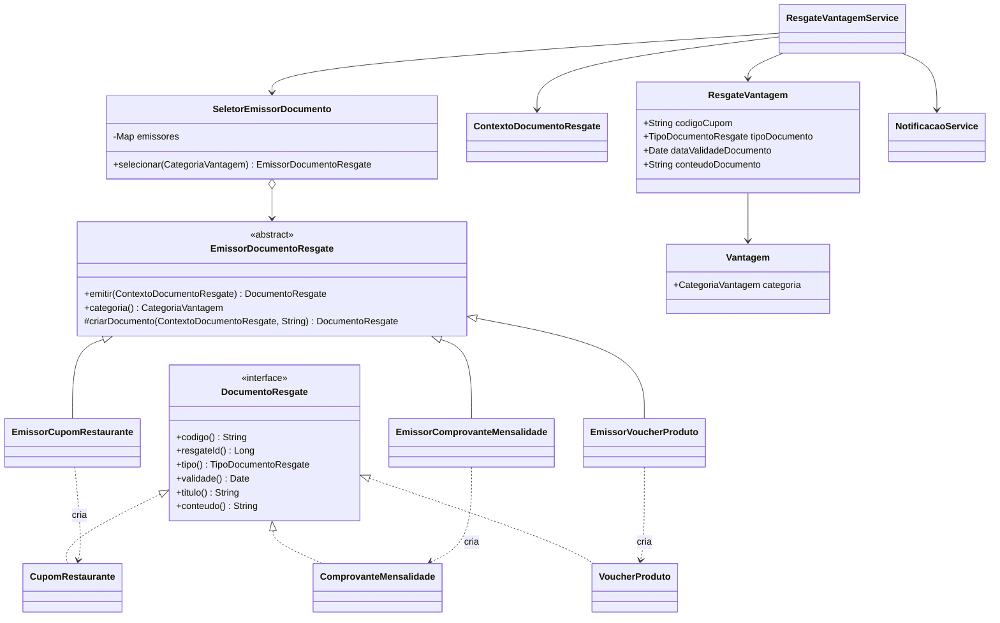
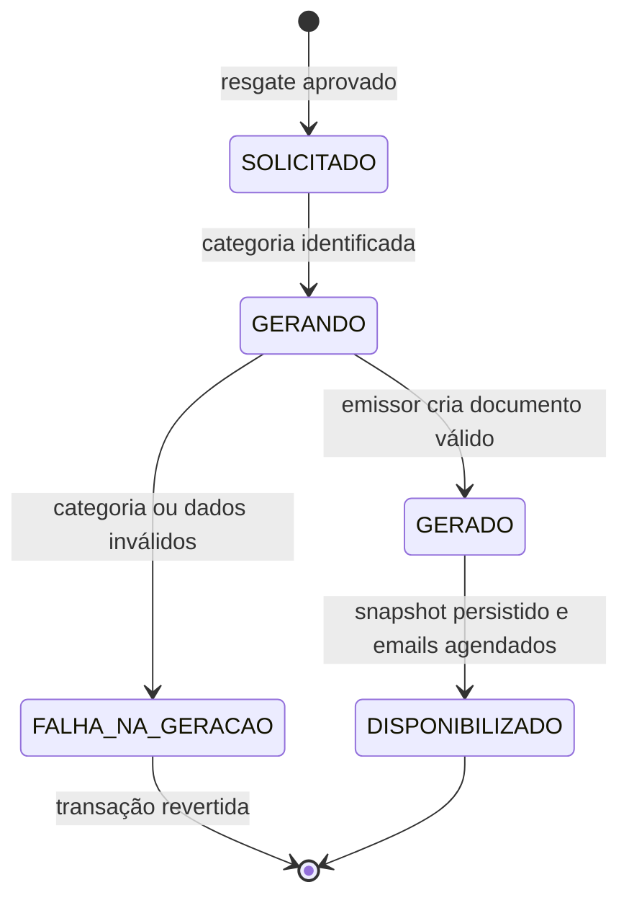
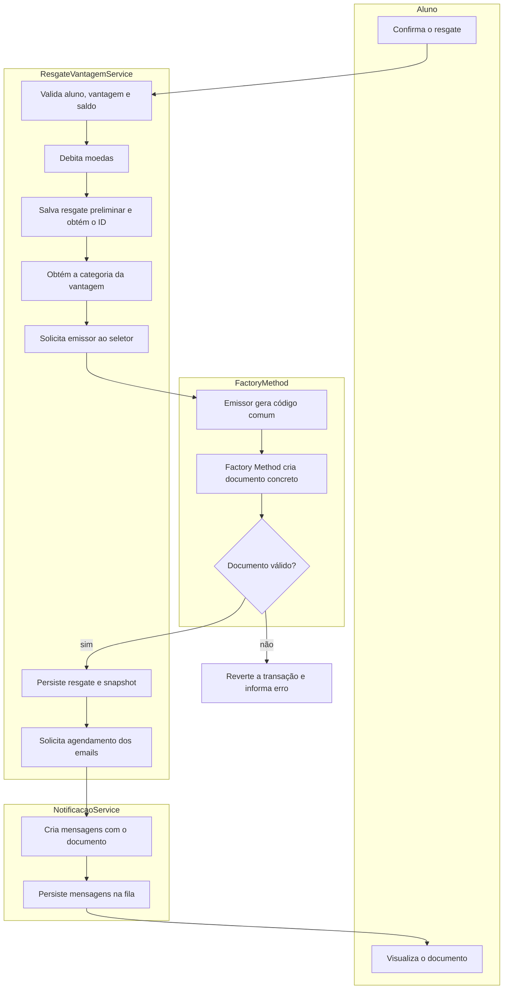
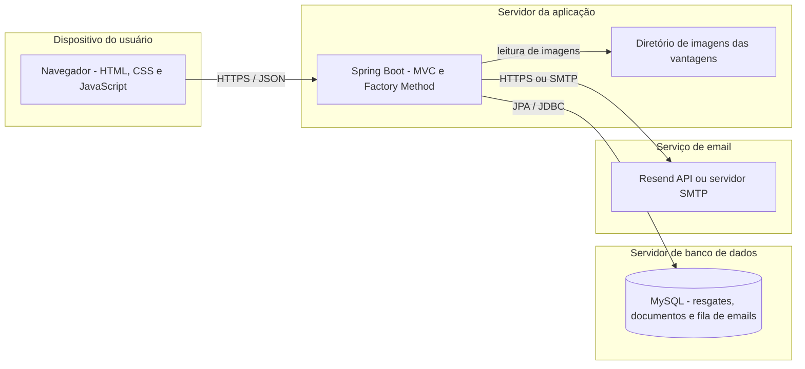

# Planejamento da funcionalidade 2.4 - Luizin

## Emissão de cupons e comprovantes de resgate - Factory Method

Este documento planeja exclusivamente a funcionalidade 2.4 da Release 3. O objetivo é definir como o sistema emitirá documentos diferentes conforme a categoria da vantagem, mantendo a integração com o fluxo atual de resgate, a arquitetura MVC e as funcionalidades 2.2 e 2.3 planejadas pelos demais integrantes.

## 1. Requisito

A seção 2.4 do enunciado exige a emissão de diferentes documentos conforme a vantagem resgatada:

- restaurante: cupom com código, desconto e instruções de uso;
- mensalidade: comprovante com código, valor do benefício e identificação do aluno;
- produto: voucher com código, identificação do produto e instruções de retirada.

Todos os documentos compartilham geração de código, identificação do resgate e conteúdo para envio por e-mail, mas possuem dados e textos específicos. O sistema deve selecionar o mecanismo de criação adequado sem concentrar a instanciação em uma classe com condicionais extensas.

## 2. Problema identificado

Atualmente, [`ResgateVantagemService`](<../demo (2)/demo/src/main/java/moedaEstudantil/service/ResgateVantagemService.java>) cria sempre o mesmo código:

```java
String codigo = "CUPOM-" + UUID.randomUUID().toString().replace("-", "")
        .substring(0, 8).toUpperCase();
```

O serviço persiste esse texto em `ResgateVantagem`, devolve-o em `ResgateResultadoDTO` e o envia ao aluno e à empresa por meio de `NotificacaoService`. Não existe categoria da vantagem nem representação dos três tipos de documento.

Adicionar restaurante, mensalidade e produto diretamente ao serviço criaria os seguintes problemas:

| Problema | Consequência |
| --- | --- |
| `if` ou `switch` por categoria dentro do resgate | O serviço passaria a conhecer a construção de todos os documentos. |
| Responsabilidades misturadas | Débito, persistência, cupom, textos e notificações ficariam na mesma classe. |
| Alteração frequente | Cada novo documento exigiria modificar o fluxo principal de resgate. |
| Testes acoplados | Para testar o texto de um cupom seria necessário preparar todo o resgate e seus repositórios. |
| Histórico instável | Se o documento fosse remontado com dados atuais, alterações na vantagem poderiam mudar um comprovante antigo. |

## 3. Padrão escolhido: Factory Method

Factory Method define uma operação comum para criação de objetos e permite que criadores concretos escolham qual produto concreto será instanciado.

Na funcionalidade 2.4:

- `DocumentoResgate` é o produto comum;
- `CupomRestaurante`, `ComprovanteMensalidade` e `VoucherProduto` são os produtos concretos;
- `EmissorDocumentoResgate` define o fluxo comum de emissão e o método fábrica;
- cada emissor concreto cria o documento da sua categoria;
- `SeletorEmissorDocumento` localiza o emissor registrado para a categoria da vantagem.

O padrão é adequado porque a variação principal está na criação do documento. O fluxo de resgate apenas solicita uma emissão e trabalha com a interface `DocumentoResgate`, sem conhecer a classe concreta.

### 3.1 Alternativas descartadas

| Alternativa | Motivo da rejeição |
| --- | --- |
| `switch` em `ResgateVantagemService` | Mantém a lógica de criação centralizada e cresce a cada novo tipo. |
| Uma única classe `Cupom` com muitos campos opcionais | Produz objetos parcialmente preenchidos e não representa as diferenças entre os documentos. |
| Strategy | É apropriado para algoritmos intercambiáveis, como o cálculo da seção 2.2. Aqui a necessidade principal é criar produtos de classes diferentes. |
| Abstract Factory | Criaria famílias inteiras de objetos relacionados, algo que o requisito não exige. |
| Builder | Ajuda a montar um objeto complexo, mas não resolve sozinho a escolha entre diferentes tipos de documento. |

## 4. Responsabilidades

| Elemento | Papel | Responsabilidade |
| --- | --- | --- |
| `CategoriaVantagem` | Identificação | Enum com `RESTAURANTE`, `MENSALIDADE` e `PRODUTO`. |
| `TipoDocumentoResgate` | Identificação | Enum com `CUPOM_RESTAURANTE`, `COMPROVANTE_MENSALIDADE` e `VOUCHER_PRODUTO`. |
| `ContextoDocumentoResgate` | Entrada | Dados imutáveis do resgate já identificado, aluno, vantagem, empresa, benefício aplicado e validade definida pelo ciclo do resgate. |
| `DocumentoResgate` | Product | Contrato comum para código, tipo, identificação do resgate, validade, título e conteúdo. |
| `CupomRestaurante` | ConcreteProduct | Apresenta desconto e instruções de uso no restaurante. |
| `ComprovanteMensalidade` | ConcreteProduct | Apresenta aluno e valor do benefício da mensalidade. |
| `VoucherProduto` | ConcreteProduct | Apresenta produto e instruções de retirada na empresa. |
| `EmissorDocumentoResgate` | Creator | Gera o código comum, valida o contexto e chama o método fábrica. |
| Três emissores concretos | ConcreteCreator | Criam o documento correspondente à sua categoria. |
| `SeletorEmissorDocumento` | Seleção | Mantém um mapa de categoria para emissor, montado com os beans injetados pelo Spring. |
| `ResgateVantagemService` | Client | Solicita a emissão, persiste o snapshot e mantém débito e transação. |
| `NotificacaoService` | Consumidor | Agenda os e-mails usando o conteúdo do documento já criado. |

## 5. Estrutura proposta

### 5.1 Contratos principais

```java
public interface DocumentoResgate {
    String codigo();
    Long resgateId();
    TipoDocumentoResgate tipo();
    Date validade();
    String titulo();
    String conteudo();
}

public abstract class EmissorDocumentoResgate {
    public DocumentoResgate emitir(ContextoDocumentoResgate contexto) {
        validar(contexto);
        String codigo = gerarCodigo();
        return criarDocumento(contexto, codigo);
    }

    public abstract CategoriaVantagem categoria();

    protected abstract DocumentoResgate criarDocumento(
            ContextoDocumentoResgate contexto, String codigo);
}
```

O método `emitir` contém somente passos comuns. O método `criarDocumento` é o Factory Method implementado por cada emissor concreto.

### 5.2 Seleção sem condicionais extensas

```java
@Component
public class SeletorEmissorDocumento {
    private final Map<CategoriaVantagem, EmissorDocumentoResgate> emissores;

    public SeletorEmissorDocumento(List<EmissorDocumentoResgate> implementacoes) {
        emissores = implementacoes.stream().collect(Collectors.toMap(
                EmissorDocumentoResgate::categoria, emissor -> emissor));
    }

    public EmissorDocumentoResgate selecionar(CategoriaVantagem categoria) {
        EmissorDocumentoResgate emissor = emissores.get(categoria);
        if (emissor == null) throw new IllegalArgumentException("Categoria sem emissor: " + categoria);
        return emissor;
    }
}
```

Uma nova categoria exigirá um novo produto e um novo emissor. O seletor e o serviço de resgate não precisarão ser alterados.

## 6. Dados de cada documento

| Documento | Dados comuns | Dados específicos |
| --- | --- | --- |
| Cupom de restaurante | código, resgate, emissão, validade, aluno, empresa | percentual ou valor do desconto e instruções de uso no estabelecimento |
| Comprovante de mensalidade | código, resgate, emissão, validade, aluno, empresa | identificação do aluno e valor do benefício |
| Voucher de produto | código, resgate, emissão, validade, aluno, empresa | identificação do produto e instruções de retirada |

O valor ou a descrição do benefício virá do resultado persistido pela funcionalidade 2.2. A funcionalidade 2.4 apenas apresenta esse resultado; ela não recalcula desconto. Da mesma forma, o estado do resgate continuará sob responsabilidade da funcionalidade 2.3.

## 7. Persistência e compatibilidade

`Vantagem` receberá o campo obrigatório `categoria`. Para preservar vantagens já cadastradas durante a atualização do banco, registros antigos serão tratados inicialmente como `PRODUTO`.

`ResgateVantagem` continuará usando os campos existentes `codigoCupom` e `dataHora`. Serão adicionados somente os dados necessários para preservar o documento emitido:

| Campo | Finalidade |
| --- | --- |
| `codigoCupom` | Mantém o código atual e recebe restrição única no banco. |
| `tipoDocumento` | Registra qual produto concreto foi gerado. |
| `dataValidadeDocumento` | Permite informar e validar o prazo de utilização. |
| `conteudoDocumento` | Snapshot do texto disponibilizado no momento do resgate, persistido como `@Lob`. |

O snapshot evita que mudanças posteriores no nome da vantagem, empresa ou instruções alterem documentos antigos. Não será criada uma nova tabela ou uma hierarquia JPA para os três produtos, pois o requisito pode ser atendido com o snapshot associado ao resgate existente.

Dentro da mesma transação, o serviço salvará o resgate preliminar para obter seu identificador antes de chamar o emissor. Depois da emissão, atualizará o mesmo registro com o snapshot. Se qualquer etapa falhar, o rollback removerá o registro preliminar e desfará o débito e as mensagens de e-mail. A sequência numérica do banco poderá manter uma lacuna, o que não afeta o negócio.

## 8. Diagrama de classes



## 9. Diagrama de estados do documento

O diagrama representa o ciclo de emissão do `DocumentoResgate`. Ele não substitui os estados do resgate definidos na funcionalidade 2.3.



Se a geração falhar, a transação de resgate será revertida. A falha posterior do provedor de e-mail não invalida o documento: a mensagem permanece na fila persistente para nova tentativa.

## 10. Diagrama de atividades



## 11. Diagrama de implantação



A geração dos documentos ocorre dentro da aplicação Spring Boot e não exige um serviço externo adicional. Resend ou SMTP apenas entrega o conteúdo já gerado. Este recorte deverá ser incorporado ao único Diagrama de Implantação geral do grupo solicitado no Lab05S02.

## 12. Integração com a arquitetura existente

| Camada | Arquivo ou componente | Mudança planejada |
| --- | --- | --- |
| `model` | `CategoriaVantagem` | Novo enum das três categorias exigidas. |
| `model` | [`Vantagem`](<../demo (2)/demo/src/main/java/moedaEstudantil/model/Vantagem.java>) | Campo `categoria`. |
| `model` | `TipoDocumentoResgate` | Novo enum dos produtos concretos. |
| `model` | [`ResgateVantagem`](<../demo (2)/demo/src/main/java/moedaEstudantil/model/ResgateVantagem.java>) | Código único, tipo, validade e snapshot do documento. |
| `service.documento` | produtos, contexto, criadores e seletor | Implementação isolada do Factory Method. |
| `service` | [`VantagemService`](<../demo (2)/demo/src/main/java/moedaEstudantil/service/VantagemService.java>) | Validar e persistir a categoria escolhida pela empresa. |
| `service` | [`ResgateVantagemService`](<../demo (2)/demo/src/main/java/moedaEstudantil/service/ResgateVantagemService.java>) | Substituir a geração fixa pelo emissor selecionado e persistir o snapshot. |
| `service` | [`NotificacaoService`](<../demo (2)/demo/src/main/java/moedaEstudantil/service/NotificacaoService.java>) | Receber `DocumentoResgate` em vez de apenas o código. |
| `email` | [`NotificacaoTemplates`](<../demo (2)/demo/src/main/java/moedaEstudantil/email/NotificacaoTemplates.java>) | Usar título e conteúdo produzidos pelo documento. |
| `dto` | `VantagemDTO` e `ResgateResultadoDTO` | Expor categoria e documento emitido. |
| `controller` | `VantagemController` | Receber a categoria no cadastro e na edição. |
| frontend empresa | `vantagens.html` e JavaScript relacionado | Adicionar seleção obrigatória da categoria. |
| frontend aluno | `resgatar-vantagens.html` e JavaScript relacionado | Exibir o tipo, a validade e o conteúdo do documento. |

O endpoint de resgate continuará sendo `POST /api/alunos/{alunoId}/resgates/{vantagemId}`. A escolha do documento é uma regra interna e não será enviada pelo aluno, impedindo que o cliente escolha um tipo incompatível com a vantagem.

## 13. Planejamento de implementação

### Etapa 1 - Modelo e compatibilidade

1. Criar os enums de categoria e tipo de documento.
2. Adicionar a categoria à vantagem, a unicidade do código e os campos de snapshot ao resgate.
3. Atualizar DTOs, cadastro e edição de vantagens.
4. Tratar vantagens antigas como `PRODUTO` durante a transição.

### Etapa 2 - Factory Method

1. Criar `DocumentoResgate` e `ContextoDocumentoResgate`.
2. Criar os três produtos concretos.
3. Criar o emissor abstrato e os três emissores concretos.
4. Criar o seletor baseado nos beans do Spring.
5. Testar cada emissor isoladamente.

### Etapa 3 - Fluxo de resgate e notificações

1. Integrar o seletor ao `ResgateVantagemService`.
2. Salvar o resgate preliminar para obter o ID e, na mesma transação, persistir código, tipo, validade e conteúdo.
3. Passar o documento ao `NotificacaoService`.
4. Manter a fila, as retentativas e os provedores de e-mail já existentes.

### Etapa 4 - Interface

1. Adicionar categoria ao formulário da empresa.
2. Exibir o documento concreto após o resgate do aluno.
3. Mostrar documento e validade no extrato sem recalcular dados antigos.

### Etapa 5 - Validação

1. Executar testes unitários dos emissores.
2. Executar testes de integração do resgate e da persistência do snapshot.
3. Verificar os três documentos na interface e nos e-mails.
4. Atualizar os diagramas UML do grupo para refletir as classes efetivamente implementadas.

## 14. Estratégia de testes

| Nível | Cenário principal |
| --- | --- |
| Unitário | Cada emissor cria o produto correto com os dados específicos obrigatórios. |
| Unitário | Categoria sem emissor e contexto incompleto são rejeitados. |
| Unitário | Código é único, possui formato válido e validade posterior à emissão. |
| Serviço | O resgate persiste o mesmo código devolvido ao aluno e enviado à empresa. |
| Serviço | Falha na geração reverte débito, transação e mensagens de e-mail. |
| Integração | Alterar a vantagem depois do resgate não modifica o snapshot antigo. |
| Integração | Falha no provedor mantém a mensagem na fila sem apagar o documento. |
| Frontend | Empresa seleciona categoria e aluno visualiza tipo, conteúdo e validade. |

## 15. Critérios de aceitação

1. Cada categoria produz o documento concreto correspondente.
2. Cada documento persistido possui um código único.
3. O serviço de resgate não contém `if` ou `switch` para montar documentos.
4. Aluno e empresa recebem o mesmo código e as informações específicas da categoria.
5. O documento permanece consultável com os dados originais após mudanças na vantagem.
6. Falha de geração não debita moedas nem cria resgate parcial.
7. Falha de envio de e-mail mantém a mensagem para retentativa.
8. O fluxo permanece integrado à arquitetura MVC e ao endpoint de resgate existente.

## 16. Decisões de escopo

- O documento será texto estruturado exibido na tela e enviado por e-mail; geração de PDF não é exigida pelo enunciado.
- Não será criado um microserviço de documentos.
- Não será criada uma tabela por tipo de documento.
- A funcionalidade 2.4 não calcula benefícios e não controla transições do resgate; ela consome os resultados das funcionalidades 2.2 e 2.3.
- A validade é recebida do ciclo de vida definido na funcionalidade 2.3; a 2.4 apenas a apresenta no documento.

## 17. Referências

- Enunciado da Release 3, seção 2.4 e processo de desenvolvimento Lab05S01-Lab05S03.
- Gamma, E. et al. *Design Patterns: Elements of Reusable Object-Oriented Software*. Addison-Wesley, 1994.
- Refactoring.Guru. [Factory Method](https://refactoring.guru/pt-br/design-patterns/factory-method).
