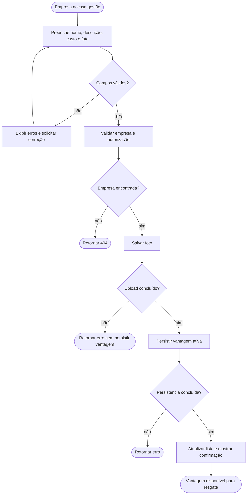

# Planejamento de implementação — Funcionalidade 2.3

**Branch:** `lab5`  
**Funcionalidade:** USER STORY 06 — Empresa parceira cadastra vantagens contendo descrição, foto do produto e custo em moedas.  
**Base:** `README.md`, arquitetura MVC existente e `padroes-de-projeto.md`.

## 1. Objetivo e escopo

Permitir que uma empresa parceira crie, consulte, edite e faça exclusão lógica de vantagens que serão exibidas aos alunos para resgate. O fluxo deve preservar a separação `controller → service → repository → model`, validar os dados obrigatórios e manter o histórico de resgates quando uma vantagem for desativada.

Incluído neste planejamento:

- cadastro e edição de nome, descrição, foto e custo em moedas;
- listagem e consulta das vantagens ativas da empresa;
- exclusão lógica, sem apagar registros históricos;
- autorização por propriedade da empresa parceira;
- exposição da funcionalidade na tela de gestão;
- testes unitários, de integração e de fluxo HTTP;
- documentação GoF e diagramas exigidos pela atividade.

Fora do escopo desta entrega: implementação das novas políticas de benefício descritas na seção 1 do documento de padrões. Elas podem ser planejadas como extensão futura da entidade `Vantagem`, sem bloquear o cadastro básico da USER STORY 06.

## 2. Requisitos rastreáveis

- **REQ-001:** uma empresa autenticada deve cadastrar uma vantagem com nome, descrição, foto e custo inteiro maior que zero.
- **REQ-002:** o sistema deve rejeitar nome ou descrição vazios, custo inválido e ausência de foto no cadastro.
- **REQ-003:** a empresa deve listar e consultar somente vantagens que pertencem a ela e estão ativas.
- **REQ-004:** a empresa deve editar os dados da própria vantagem, mantendo a foto anterior quando nenhuma nova foto for enviada.
- **REQ-005:** a remoção deve ser lógica (`ativa = false`), preservando a vantagem para referências de resgates antigos.
- **REQ-006:** tentativas de acessar ou alterar vantagem de outra empresa devem retornar recurso não encontrado, sem expor dados.
- **REQ-007:** a interface deve oferecer cadastro, edição, exclusão e feedback de sucesso/erro para a empresa.
- **REQ-008:** o comportamento existente de resgate e catálogo do aluno deve continuar funcionando após a mudança.
- **REQ-009:** a solução deve documentar padrões GoF, responsabilidades, justificativas, integração arquitetural e os diagramas de estados e atividades.

## 3. Diagnóstico do estado atual

O backend já possui a maior parte do fluxo em:

- `demo (2)/demo/src/main/java/moedaEstudantil/controller/VantagemController.java`;
- `demo (2)/demo/src/main/java/moedaEstudantil/service/VantagemService.java`;
- `demo (2)/demo/src/main/java/moedaEstudantil/model/Vantagem.java`;
- `demo (2)/demo/src/main/java/moedaEstudantil/repository/VantagemRepository.java`;
- `demo (2)/demo/src/main/resources/static/vantagens.html` e `js/vantagens.js`.

Também existem testes unitários de `VantagemService` e uma implementação funcional de exclusão lógica. A execução deve começar confirmando esse baseline e identificando qualquer divergência entre os arquivos estáticos em `frontend/` e os arquivos servidos pelo Spring em `demo (2)/demo/src/main/resources/static/`.

## 4. Padrões GoF e responsabilidades

### 4.1 Facade — padrão principal do caso de uso

`VantagemService` funciona como uma fachada para o caso de uso de gestão: recebe a solicitação do controller, valida regras, resolve a empresa, delega o armazenamento da imagem e persiste a entidade. O controller não deve conhecer repository, storage ou regras de autorização.

**Justificativa:** reduz o acoplamento do controller e oferece uma entrada única para criar, listar, consultar, editar e remover vantagens. A fachada é compatível com a arquitetura em camadas já usada no projeto.

### 4.2 Repository — padrão de acesso a dados

`VantagemRepository` encapsula consultas de vantagens ativas, por empresa e por identificador. O serviço depende da abstração do repository, sem construir SQL ou acessar JPA diretamente.

**Justificativa:** mantém persistência isolada, facilita testes com mocks e permite evoluir as consultas sem alterar o fluxo do caso de uso.

### 4.3 Strategy — extensão planejada para políticas de benefício

O documento `padroes-de-projeto.md` propõe `PoliticaBeneficio` e suas estratégias para cálculo de descontos. Nesta funcionalidade, o cadastro deve manter campos compatíveis com essa evolução, mas não implementar a regra de cálculo sem requisito explícito da USER STORY 06.

**Justificativa:** evita misturar cadastro de vantagem com cálculo de resgate. Quando a extensão for executada, o serviço de resgate poderá delegar a uma calculadora sem concentrar condicionais no serviço.

## 5. Plano de implementação

### Fase 1 — baseline e contratos

- [ ] T001 [Plan:1.1] Confirmar branch `lab5`, estado limpo e comandos de build/teste em `demo (2)/demo/pom.xml`.
- [ ] T002 [Plan:1.2] Documentar contrato dos endpoints `GET`, `POST`, `PUT` e `DELETE` de `/api/empresas/{empresaId}/vantagens`, incluindo status 201, 204, 400 e 404.
- [ ] T003 [Plan:1.3] Comparar `frontend/` com `demo (2)/demo/src/main/resources/static/` e definir a fonte oficial ou o procedimento de sincronização.

### Fase 2 — domínio, persistência e regras de negócio

- [ ] T004 [Plan:2.1] Revisar `Vantagem` e `VantagemRepository` para garantir os campos obrigatórios, associação com `EmpresaParceira`, filtro de ativos e compatibilidade com resgates.
- [ ] T005 [Plan:2.2] Consolidar em `VantagemService` a validação de texto, custo, foto obrigatória no cadastro, foto opcional na edição e autorização por empresa.
- [ ] T006 [Plan:2.3] Garantir que `remover` altere apenas `ativa`, sem excluir a linha nem remover referências históricas.
- [ ] T007 [P] [Plan:2.4] Revisar `ArquivoStorageService` para impedir nomes inseguros, validar tipo/tamanho de imagem e remover a foto anterior apenas depois de salvar a nova.

### Fase 3 — API e interface da empresa

- [ ] T008 [Plan:3.1] Ajustar `VantagemController` para receber os campos multipart com mensagens de erro consistentes e encaminhar toda regra ao service.
- [ ] T009 [P] [Plan:3.2] Completar `VantagemDTO` e o mapeamento de saída sem expor dados internos da entidade.
- [ ] T010 [P] [Plan:3.3] Implementar em `vantagens.html` o formulário de criação/edição, validações visuais, prévia da foto e acessibilidade básica.
- [ ] T011 [P] [Plan:3.4] Implementar em `js/vantagens.js` e `js/vantagens-api.js` os fluxos de carregar, criar, editar, remover e atualizar a lista após sucesso.
- [ ] T012 [Plan:3.5] Sincronizar os arquivos estáticos oficiais e verificar que a tela de gestão usa o `empresaId` correto da sessão.

### Fase 4 — testes e diagramas da atividade

- [ ] T013 [P] [Plan:4.1] Ampliar `VantagemServiceTest` para cobrir cadastro válido, validações, edição, preservação de foto, autorização e exclusão lógica.
- [ ] T014 [P] [Plan:4.2] Criar testes do controller ou integração HTTP para os contratos multipart e códigos de resposta.
- [ ] T015 [P] [Plan:4.3] Criar testes de frontend para submissão, edição, remoção, estados de carregamento e mensagens de erro.
- [ ] T016 [Plan:4.4] Criar o diagrama de estados de `Vantagem` com os estados `RASCUNHO`, `ATIVA`, `EDITADA` e `INATIVA`, explicitando eventos e restrições.
- [ ] T017 [Plan:4.5] Criar o diagrama de atividades do cadastro, com validação, upload, persistência, retorno de erro e confirmação.
- [ ] T018 [Plan:4.6] Registrar a justificativa dos padrões Facade, Repository e Strategy e relacionar cada participante às classes reais do projeto.

### Fase 5 — validação final e entrega

- [ ] T019 [Plan:5.1] Executar testes Java e frontend, revisar cobertura dos REQ-001 a REQ-008 e corrigir regressões no resgate do aluno.
- [ ] T020 [Plan:5.2] Revisar documentação e links dos artefatos, conferir diff apenas da tarefa e atualizar o README se o formato de entrega exigir.
- [ ] T021 [Plan:5.3] Fazer commit de todas as alterações da tarefa na branch `lab5` com mensagem descritiva.

## 6. Diagramas planejados

### 6.1 Estados de `Vantagem`

```mermaid
stateDiagram-v2
    [*] --> RASCUNHO: formulário iniciado
    RASCUNHO --> ATIVA: dados válidos + foto salva
    RASCUNHO --> RASCUNHO: erro de validação ou upload
    ATIVA --> EDITADA: empresa atualiza dados
    EDITADA --> ATIVA: dados válidos + persistência concluída
    EDITADA --> ATIVA: erro; mantém versão anterior
    ATIVA --> INATIVA: empresa solicita remoção lógica
    INATIVA --> [*]
    INATIVA --> ATIVA: somente se houver regra explícita de reativação futura
```

### 6.2 Atividades do cadastro

## 7. Critérios de aceite

- Uma empresa consegue cadastrar uma vantagem válida e vê o item na sua lista sem recarregar manualmente.
- Nome, descrição, foto e custo são validados antes da persistência.
- Uma empresa não consegue consultar, editar ou remover vantagem de outra empresa.
- A remoção não apaga a entidade e não quebra um resgate já registrado.
- A edição sem nova foto preserva o arquivo anterior; com nova foto, o arquivo antigo é removido após o novo ser armazenado.
- O catálogo do aluno continua listando apenas vantagens ativas.
- Os diagramas e a explicação dos padrões permitem rastrear responsabilidades até as classes do projeto.

## 8. Requirement Mapping

| REQ ID | Descrição | Plan items | Evidência de implementação |
|---|---|---|---|
| REQ-001 | Cadastro completo de vantagem | 2.1, 2.2, 3.1, 3.3 | `Vantagem`, `VantagemService`, `VantagemController`, `vantagens.html` |
| REQ-002 | Validações de entrada | 2.2, 4.1, 4.2 | `VantagemServiceTest` e contrato HTTP |
| REQ-003 | Consulta apenas de vantagens próprias e ativas | 2.1, 2.2, 3.1 | `VantagemRepository` e `VantagemService` |
| REQ-004 | Edição e preservação de foto | 2.2, 2.4, 3.3, 4.1 | `ArquivoStorageService`, service e tela |
| REQ-005 | Exclusão lógica | 2.3, 4.1 | campo `ativa` e teste de não exclusão física |
| REQ-006 | Isolamento por empresa | 2.2, 3.1, 4.1 | busca por proprietário e testes 404 |
| REQ-007 | Fluxo de interface | 3.3, 3.4, 4.3 | HTML, JavaScript e testes frontend |
| REQ-008 | Não regressão no resgate/catalogo | 1.3, 5.1 | testes de `ResgateVantagemService` e catálogo |
| REQ-009 | Padrões e diagramas | 4.4, 4.5, 4.6, 5.2 | este plano e artefatos Mermaid/documentais |

## 9. Estratégia de validação

1. Executar os testes unitários Java com Maven no módulo `demo (2)/demo`.
2. Executar os testes JavaScript existentes e os novos testes de `vantagens`.
3. Subir o backend localmente e validar manualmente os quatro endpoints com uma empresa de teste.
4. Confirmar no catálogo do aluno que uma vantagem ativa aparece e uma vantagem removida não aparece.
5. Revisar o diff, confirmar que não há arquivos gerados ou credenciais, e então criar o commit na branch `lab5`.

## 10. Riscos e decisões

- O projeto mantém cópias do frontend em duas pastas; a sincronização precisa ser decidida antes de editar para evitar divergência.
- O banco usa `ddl-auto=update`; alterações futuras na entidade devem ser verificadas em ambiente de teste para não perder dados.
- A exigência de foto no cadastro e opcional na edição é mantida porque já está implementada e corresponde à USER STORY 06.
- A estratégia de benefícios do documento de padrões é tratada como evolução separada; implementá-la nesta tarefa aumentaria o escopo além do cadastro solicitado.
